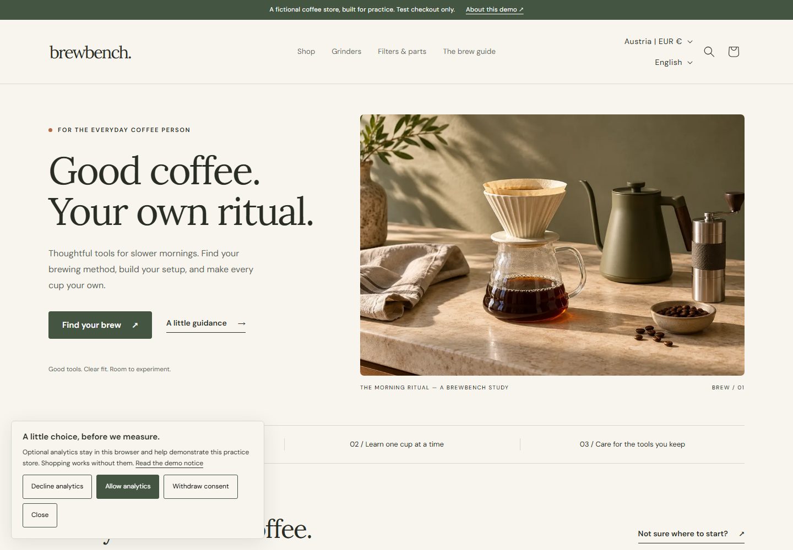

# Brewbench

A fictional home-coffee Shopify store, built to practise theme engineering, structured content, international shopping, CRO, measurement and release operations.

[Development storefront](https://brewbench-practice.myshopify.com) · [Editable Figma design](https://www.figma.com/design/NjRmHGtjzq5QlDZSGOcVHW) · [QA evidence](docs/QA.md) · [Release record](docs/RELEASE.md)

The free development store is password protected. The password is shared privately; it is not in this repository. Checkout uses Shopify's test gateway. No goods are shipped and no real payments are taken. **There is no CI.** All validation, tests, deployment and rollback run locally.



## What is implemented

- 24 original fictional products, 26 variants, nine collections, five bilingual information pages, native categories and tracked inventory.
- English and German; Austria, Germany and UK delivery with distinct EUR rates. Thermal Carafe is excluded from the UK catalog.
- Six reusable theme components: editorial hero, brewing methods, specifications, exact-variant compatibility, shared brewing guide and FAQ.
- Native sorting, search, pagination, cart drawer/cart page and Shopify checkout. Rapid option changes, sold-out combinations, stock errors and country changes reconcile against Shopify's response.
- Merchant-owned metafields/metaobjects, native translations and repeatable catalog tools that preserve stock on ordinary reruns.
- An affirmative-consent compatibility experiment, local QA event recorder, fixture-tested customer-event mappings and explicitly synthetic funnel analysis.
- Native editable Figma screens/components, original generated images, browser/accessibility tests, measured performance changes and three controlled troubleshooting exercises.

## Run locally

Use Node.js 24, Shopify CLI **4.9.4**, a suitable development store and authorized Shopify/GitHub accounts. Admin GraphQL is pinned to **2026-10**. The storefront is a Liquid theme; no application server or separate hosting is needed.

```powershell
npm install --global @shopify/cli@4.9.4
npm ci
npx playwright install chromium firefox webkit
npm run check
npm run theme:check
```

`npm ci` installs the locked dependencies locally; it does not configure continuous integration.

For the authenticated store, follow [operations](docs/OPERATIONS.md): authorize the CLI, keep the storefront password in ignored `.local/preflight/storefront-password.txt`, snapshot the store, review the dry run, then apply and verify the manifests. Geography and sample-retirement commands deliberately guard the dedicated practice store. Review those guards before adapting this project to another store.

```powershell
npm run store:plan
npm run store:snapshot
npm run store:apply
node scripts/store/geography.mjs apply
npm run store:verify
node scripts/store/geography.mjs verify
$env:SHOPIFY_THEME_ID = '<your unpublished candidate theme ID>'
shopify theme push --store brewbench-practice.myshopify.com --theme $env:SHOPIFY_THEME_ID --path theme --json
npm run test:browser
```

Browser tests can use `SHOPIFY_THEME_ID`; the original developer's ignored resource ledger is the fallback. `SHOPIFY_PASSWORD_FILE` can select another local credential file. See `.env.example`; environment files are not loaded automatically. To preview locally, load the private password into `SHOPIFY_FLAG_STORE_PASSWORD` and run `shopify theme dev --store brewbench-practice.myshopify.com --path theme`.

## Read the project

| Area | Entry point |
|---|---|
| Scope, research and decisions | [Implementation plan](docs/IMPLEMENTATION_PLAN.md), [feasibility](docs/FEASIBILITY.md) |
| Theme and tool architecture | [Architecture](docs/ARCHITECTURE.md) |
| Catalog and shared content | [Data dictionary](docs/DATA_DICTIONARY.md) |
| Design and asset rights | [Design source](design/README.md), [provenance](design/assets/provenance.json) |
| Experiment and evidence levels | [Analytics contract](docs/ANALYTICS.md), [synthetic report](docs/SYNTHETIC_ANALYSIS.md) |
| Quality and operations | [QA](docs/QA.md), [performance](docs/PERFORMANCE.md), [incidents](docs/INCIDENTS.md) |
| Delivery and walkthrough | [Release](docs/RELEASE.md), [walkthrough](docs/WALKTHROUGH.md) |

## Deliberate boundaries

This is a password-protected practice store, not a production business. All three countries use EUR; there is no simulated GBP checkout. Demo tax is not calculated. Native configurable facets were replaced with collection/method navigation because the agreed workflow excludes Shopify admin configuration. No app installation, Flow, Functions, checkout extension, backend, external analytics collector or 250-product exercise is included.

Theme interactions are observed in the browser. Checkout/purchase event adapters use fixtures; completing a test order does not imply that a live purchase pixel is installed. The experiment report contains generated data and makes no real conversion-lift claim. Automated WebKit is not real Safari/iPhone testing. The actual theme editor was not used; configurations were exercised through code and CLI.

The theme derives from Shopify Dawn **16.0.0** (`bc39a7d2024f1e5c14c42f855bd3552b4913e204`) and retains its [Shopify license](theme/LICENSE.md). Original tooling/data/documentation are covered by [LICENSE](LICENSE); see [NOTICE](NOTICE.md) and the font licenses for the separate terms. Branding, copy and generated imagery are independent fictional work.
